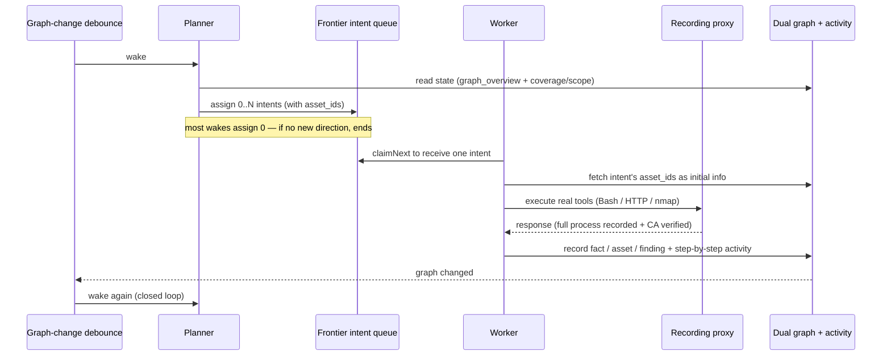

# Especificación para Construir un Sistema Tipo ARTEX

> **Objetivo**: Crear un **sistema autónomo de pruebas de penetración impulsado por LLM multi-agente** que pueda descubrir, explorar y explotar vulnerabilidades en redes autorizadas con mínima intervención humana, manteniendo trazabilidad completa y capacidades defensivas.

---

## Arquitectura General

### Capas del Sistema

| Capa | Tecnología | Responsabilidad |
|------|------------|-----------------|
| **Frontend** | Next.js (embebido via `go:embed`) | Dashboard, grafo de activos, grafo de exploración, hallazgos, tráfico, chat humano-en-el-bucle |
| **Backend** | Go (net/http) | API REST + SSE, auth JWT, programación de motores, almacenamiento PostgreSQL |
| **Motor de Agentes** | SDK Norma | Planificador, Workers (N concurrentes), Agente Principal, Extractora de Objetivos |
| **Persistencia** | PostgreSQL + pgx | Grafo dual idempotente, esquema embebido |
| **Subsistemas** | Go | Proxy MITM, Puerta de aprobación, Enriquecimiento, MCP/Habilidades/Memoria/Reporter |

---

## Grafo Dual: Núcleo del Sistema

### 1. Grafo de Activos (Global, Compartido)
```
root_domain → subdomain → service → endpoint
```
- Nodos: `root_domain / subdomain / ip / service / app / endpoint`
- Pertenece a una **company**
- Deduplicación por claves canónicas computadas por el programa
- Los agentes solo envían información raw; el sistema calcula relaciones

### 2. Grafo de Exploración (Por Tarea, Independiente)
```
goal → intent → fact → finding → hint
```
- Nodos: `goal / intent / fact / finding / hint`
- Aristas: `spawns / yields / derived_from / proves`
- Forma cadenas de linaje completas

### 3. Anclas (Vinculan Ambos Grafos)
```
exploration_anchors(node_id, asset_id)
```
- Permiten consultar bidireccionalmente:
  - Desde exploración: qué activo se atacó
  - Desde activo: qué intención lo probó y qué hechos produjo

---

## Motor de Agentes: Loop Cerrado Event-Driven



### Características Clave
- **Event-driven**: el planner solo despierta cuando el grafo cambia
- **Stateless por ronda**: cada wake es sesión fresca; el estado persiste en el grafo
- **Asignación 0..N**: la mayoría de rondas asignan 0 intenciones
- **Worker = intención única**: ejecuta, escribe, termina

---

## Planificador con Todo-List Compartido Persistente

### Problema que Resuelve
Cadenas de ataque reales son secuencias ordenadas con dependencias (ej: injection → creds → lateral movement → priv esc). Desplegarlas en paralelo las enreda.

### Solución: Todo-List Compartida
- Persiste por tarea, residente a través de wakes
- Registra la cadena serial **una vez**
- En rondas posteriores, asigna **un paso a la vez** en orden de dependencias
- Marca pasos como completados cuando sus hechos prerrequisitos existen

```
Shared TodoList (persiste por tarea)
┌─────────────────────────────────────────────────────┐
│ 1. Find injection point          [DONE]            │
│ 2. Obtain credentials            [IN PROGRESS]     │
│ 3. Lateral movement              [AWAITING PREREQ] │
│ 4. Privilege escalation          [AWAITING PREREQ] │
└─────────────────────────────────────────────────────┘
       │ prerequisite satisfied    │                    │
       ▼                           ▼                    ▼
   Round 1                    Round 2              Round 3
   dispatch intent ①        dispatch intent ②    dispatch intent ③
```

---

## Intercambio de Información a Nivel de Proceso entre Workers

En exploración profunda, observaciones valiosas surgen durante la ejecución de un worker sin convertirse en hechos formales. Para evitar duplicación y permitir que workers posteriores construyan sobre observaciones previas:

### Herramientas de Intercambio
| Herramienta | Propósito |
|-------------|-----------|
| `search_all_worker_traces(query)` | Busca en ejecuciones de OTROS workers por palabra clave (excluye el propio) |
| `list_worker_traces` | Lista qué workers han ejecutado |
| `get_worker_trace(intent_id, step_ids[])` | Obtiene contenido completo de pasos específicos |

### Flujo
```
Worker A (intent #12) ── per-step activity ──► Exploration Graph Activity Store
Worker B (intent #34) ── per-step activity ──►
Worker C (intent #56) ── search_all_worker_traces(q) ──► hits in A/B steps
Worker C ── get_worker_trace(intent_id, step_ids) ──► full process content
```

---

## Herramientas del Agente (Catálogo SDK Norma)

### Grafo de Activos
- `insert_assets` — registrar nuevos activos (subdominios, servicios, endpoints, credenciales, huellas)
- `list_assets` — consultar activos con filtros DSL
- `get_asset` — obtener detalle de un activo

### Grafo de Exploración
- `record_fact` — conclusiones/hechos (summary + detail + evidence + confidence)
- `report_finding` — vulnerabilidades confirmadas con PoC reproducible
- `add_hint` — inyectar pistas para el planner
- `add_intent` — inyectar intención de alta prioridad (main agent)

### Red y Reconocimiento
- `bash` — ejecución de comandos (Kali tooling via proxy)
- `web_fetch` — peticiones HTTP/HTTPS (via proxy MITM)
- `nmap` — escaneo de puertos/servicios
- `dnsx` — resolución DNS masiva
- `curl` — peticiones HTTP directas

### Tráfico (solo si captura activa)
- `traffic_search` — buscar en tráfico grabado (requiere host, soporta body_contains)
- `traffic_get` — obtener request/response completo por ID
- `traffic_blob` — leer blobs grandes por chunks (SHA256)

### Gestión y Observación
- `graph_overview` — snapshot situacional (activos, hechos, hallazgos, coverage)
- `list_findings` / `list_facts` — listar con filtros
- `get_worker_output` — ver ejecución completa de un worker

### Steering (Main Agent)
- `set_goals` — crear/actualizar objetivos de tarea
- `add_intent` — inyectar intención prioritaria (priority 8-10)
- `add_hint` — pista estratégica para planner
- `steer_work` — corrección en caliente de worker corriendo
- `set_constraints` — allow/deny por tipo de operación

---

## Agente Principal (Main Agent) — Interfaz Humana

### Principio Fundamental
> **NO explora, solo observa y dirige**

### Responsabilidades
1. **Observar**: `graph_overview`, `list_findings`, `list_facts`, `list_assets`, `get_worker_output`
2. **Dirigir (Steering)**:
   - Cambio de dirección → `add_hint`
   - "Testea X ahora" → `add_intent` (prioridad 8-10)
   - Corrección en caliente → `steer_work` (previa `get_worker_output`)
   - Nuevo objetivo final → `set_goals` (auto-resume tareas completadas)
   - Restricciones operacionales → `set_constraints` (allow/deny)
3. **Responder concisamente** en lenguaje humano

### ⚡ REGLA PROACTIVA CRÍTICA
> **Cuando el humano pide ACCIÓN (testear, escanear, verificar, descubrir, explotar), USA HERRAMIENTAS INMEDIATAMENTE — no preguntes, ejecuta.**

| Situación | Acción |
|-----------|--------|
| Sin tarea activa | `set_goals` (crea tarea) → `add_intent` (acción específica) |
| Tarea activa | `add_intent` (inyecta acción como prioridad alta) |
| Verificación puntual ("checkea admin/admin en mi router") | `add_intent` directo con descripción accionable |

**Ejemplo de intent description**: *"Discover local gateway and test admin/admin credentials on router web interface"*

---

## Subsistemas de Soporte

### Proxy MITM Grabador
- Intercepta **todo** HTTP/HTTPS de workers
- Re-firma certificados con CA propia por tarea
- Almacena request/response completos (headers, body, timing)
- Herramientas `traffic_*` consultan este almacén
- Expone CA para `SSL_CERT_FILE`, `REQUESTS_CA_BUNDLE`, `CURL_CA_BUNDLE`, `GIT_SSL_CAINFO`, `NODE_EXTRA_CA_CERTS`

### Puerta de Aprobación (Guard/Intercept)
- Reglas: `allow` / `deny` por comando, host, herramienta, patrón regex
- Modo interactivo: humano aprueba/deniega en UI antes de ejecución
- Auditoría completa en `audit_log` (quién, qué, cuándo, decisión)

### Enriquecimiento Asíncrono
- DNS pasivo/activo, HTTP fingerprinting, certificados TLS
- Corre en background, alimenta grafo de activos sin bloquear workers
- Configurable: intervalos, scope, rate limits

### Habilidades (Skills)
- Paquetes reutilizables: `SKILL.md` + scripts + templates
- Ejemplos: `api-recon`, `playwright-cli`, `scopesentry`, `termux-netdiscover`
- Se asignan a agentes via UI; empaquetadas como meta-tool `Skill`

### MCP (Model Context Protocol)
- Servidores externos vía stdio/SSE
- Herramientas expandidas como `mcp__server__tool`
- Ejemplos: Playwright, filesystem, GitHub, databases

### Memoria
- Persistencia cross-sesión de hallazgos/contexto
- Vector store opcional para RAG sobre hallazgos previos

### Reporter
- Genera reportes estructurados desde el grafo
- Export: PDF, Markdown, JSON, CSV
- Plantillas personalizables

---

## Especificaciones Técnicas Detalladas

### Base de Datos (PostgreSQL + pgx)
```sql
-- Tablas principales (esquema idempotente embebido)
companies, assets, task_scope,
exploration_nodes, exploration_edges, exploration_anchors,
activities, agent_prompts, tools, skills, mcp_servers,
llm_profiles, findings, constraints, tasks, goals, intents,
users, sessions, audit_log
```
- Índices optimizados para consultas de grafo (adyacencia, anclas, coverage)
- Migraciones automáticas al arranque (`go:embed`)

### LLM Pool
- **Proveedores**: Anthropic, OpenAI, OpenAI-compatible (Ollama, vLLM, LM Studio, etc.)
- **Perfiles configurables**: modelo, base_url, proxy, max_tokens, temperature
- **Fallback automático**: cuota/error 402 → siguiente proveedor
- **Streaming + no-streaming**, compaction NOA experimental
- **Output tokens**: configurable por perfil (evita 400 max_tokens too large)

### Prompts de Agentes (Editables en BD)
| Agente | Variable Template | Cola Fija (Code-Owned) |
|--------|-------------------|------------------------|
| Worker | `WorkerVars{ProxyAddr, WorkerName, DataDir, Now}` | Traffic-tools + Artifact-spec + Lang-directive |
| Planner | `PlannerVars{Goal, Scope, AssetSummary, DataDir, Now}` | Artifact-spec + Lang-directive |
| MainAgent | `MainVars{Goal, AssetSummary, FindingsSummary, DataDir, Now}` | Artifact-spec + Lang-directive |
| Goals | `GoalsVars{EngagementDescription, DataDir, Now}` | Artifact-spec |

### Output-Language Directive
- Fuerza idioma de salida (en/ko/zh/es/ja) **SIN traducir razonamiento interno**
- Preserva rendimiento benchmarkado en idioma original
- Solo localiza: `record_fact.summary/detail`, `report_finding.*`, `planner situation summary`, `final one-liner`, `chat replies`
- **Preserva verbatim**: comandos, payloads, código, URLs, parámetros, logs/raw response excerpts

---

## Seguridad y Legalidad (No Negociable)

| Medida | Implementación |
|--------|----------------|
| **Solo entornos autorizados** | Warning prominente en README, UI, logs |
| **Setup token** | Generado al arranque sin password; requerido en `/setup` y `POST /api/auth/init` |
| **Bind por defecto** | `127.0.0.1:8787` (localhost only); LAN requiere flag explícito |
| **Rate-limit setup** | Intentos fallidos de setup token limitados |
| **Cambio de password** | Invalida todas las sesiones (clave de firma ligada a hash) |
| **CORS** | Solo orígenes en `ARTEX_CORS_ORIGINS` |
| **Licencia** | AGPL-3.0 — derivados deben liberar fuente completa |
| **Auditoría completa** | Cada acción humano/agente en `audit_log` |
| **Constraints operacionales** | Allow/deny inyectados en planner/worker prompts |

---

## Despliegue

### Binario Único (Recomendado)
```bash
# Build
cd web && npm ci && npm run build:static && cd ..
rm -rf server/webui/dist && mkdir -p server/webui/dist && cp -a web/out/. server/webui/dist/
CGO_ENABLED=0 go build -tags embedui -o artex ./cmd/artex

# Run
./start.sh  # supervisor con auto-restart en código 75
```

### Docker (Multi-arch)
```dockerfile
# Imagen base: python:3.12-slim (herramientas preinstaladas)
# Binary precompilado por CI (amd64/arm64 sin QEMU para Go/Next)
# Herramientas: nmap, playwright, node, ripgrep, curl, vim, etc.
# Volúmenes: /app/data (SQLite + jwt.key), /app/skills
```

### Docker Compose
```yaml
services:
  artex:
    image: ghcr.io/usuario/artex-global:${TAG:-latest}
    ports: ["8787:8787", "8788:8788"]
    volumes: ["./skills:/app/skills", "./data:/app/data"]
    environment:
      - ARTEX_PG_DSN=postgres://artex:pass@db:5432/artex
  db:
    image: postgres:16
    environment:
      - POSTGRES_USER=artex
      - POSTGRES_PASSWORD=pass
      - POSTGRES_DB=artex
    volumes: ["pgdata:/var/lib/postgresql/data"]
```

### Script Supervisor (`start.sh`)
- Reinicio automático en código **75** (auto-update aplicado)
- Backoff exponencial en fallos: 1s → 2s → 4s → ... máx 60s
- Forward SIGTERM a proceso hijo (crítico en Docker)
- Exit 0 = usuario detuvo; no reinicia

---

## Flujo de Trabajo Típico

```bash
# 1. Setup inicial
./start.sh                          # PostgreSQL + ARTEX
# → UI en http://127.0.0.1:8787
# → /setup con token del log
# → Password admin

# 2. Configurar LLM
# Settings → LLM Settings → API Key (Anthropic/OpenAI/compatible)

# 3. Crear tarea via Chat
"Escanea 192.168.1.0/24 y busca credenciales por defecto en routers"

# 4. MainAgent ejecuta:
#    set_goals("Descubre gateway y prueba admin/admin en routers")
#    add_intent("Discover local gateway and test admin/admin credentials on router web interface")

# 5. Planner descompone → emite intenciones priorizadas
# 6. Workers ejecutan:
#    bash -c "</dev/tcp/192.168.1.1/80"
#    nmap -sn 192.168.1.0/24
#    curl -u admin:admin http://192.168.1.1
#    → escriben hechos/hallazgos en grafo dual

# 7. Humano observa en dashboard, inyecta add_hint / steer_work si corrige rumbo

# 8. Reporte: Generación automática o manual desde hallazgos confirmados
```

---

## Entregables Mínimos Viables (MVP)

| Componente | Criterio de Aceptación |
|------------|------------------------|
| Backend Go + PostgreSQL | API REST + SSE + auth JWT funcional |
| Frontend Next.js embebido | Build estático + `go:embed` + dashboard básico |
| Motor planificador + workers | Loop cerrado con grafo dual persistente |
| Herramientas Bash/WebFetch/nmap | Registradas en SDK, ejecutan via proxy |
| Proxy MITM + CA | Grabación completa, traffic_* tools funcionales |
| MainAgent con steering | add_intent, set_goals, steer_work operativos |
| Prompts editables en BD | Con fallback built-in idéntico |
| Output-language directive | 5 idiomas, razonamiento intacto |
| Scripts de despliegue | start.sh, Docker, install.sh funcionando |
| Documentación legal/uso | AGPL-3.0 + warnings prominentes |

---

## Extensiones Futuras (Post-MVP)

- **Agentes especializados**: fuzzing, post-exploitation, lateral movement, cloud recon
- **Integración SIEM/SOAR**: Export Sigma rules, MISP indicators, ATT&CK layers
- **Modo Blue Team**: Genera detecciones a partir de comportamiento observado
- **Marketplace de habilidades**: Instalación/actualización via UI con versionado
- **Modelos locales cuantizados**: GGUF/EXL2 sin API externa (llama.cpp, exllama)
- **Multi-usuario con RBAC**: Workspaces aislados, roles (admin/analyst/viewer)
- **Colaboración en tiempo real**: Cursors compartidos, annotations en grafo
- **Simulación de adversario**: Replay de cadenas de ataque para validar detecciones

---

## Principios de Diseño No Negociables

1. **Autonomía Real** — El sistema completa cadenas de ataque multi-paso sin intervención humana continua
2. **Trazabilidad Total** — Cada hallazgo tiene linaje completo: intención → herramienta → evidencia → hecho → hallazgo
3. **Humano en el Bucle, No en el Camino** — Chat para dirigir estrategia, no para micromanagear ejecución
4. **Preservar Rendimiento del Modelo** — Prompts de razonamiento en idioma original, solo salida localizada
5. **Defensa por Diseño** — Material de detección (Sigma, Suricata, ATT&CK) generado desde arquitectura
6. **Legalidad Ante Todo** — Solo autorizado, bind localhost default, setup token, auditoría completa

---

## Referencias de Implementación

- **Upstream**: Autumn-27/ARTEX (AGPL-3.0)
- **SDK**: Autumn-27/norma (agentcore, harness, llm, tool, transcript, permission)
- **Global Edition**: jiwoochris/artex-global (i18n en/ko/zh/es/ja, prompts en inglés)
- **Termux Adaptation**: DevMaker-face/artex-global-termux (android/arm64, network discovery skill)

---

> **Nota**: Esta especificación describe un sistema completo listo para implementar. Cada componente está desacoplado pero integrado vía el grafo dual y el SDK Norma, permitiendo evolución independiente manteniendo coherencia operacional.