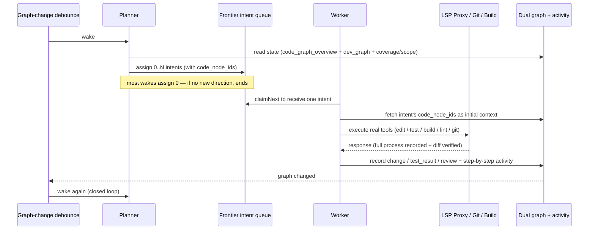

# Especificación DEVEX: Sistema Agéntico Autónomo de Desarrollo de Software

> **Objetivo**: Crear un **sistema autónomo de desarrollo de software multi-lenguaje impulsado por LLM multi-agente** que pueda diseñar, implementar, testear, refactorizar y desplegar aplicaciones (APK, Python, Web, CLI, etc.) con mínima intervención humana, manteniendo trazabilidad completa desde requerimiento hasta artefacto desplegado.

---

## Arquitectura General

### Capas del Sistema

| Capa | Tecnología | Responsabilidad |
|------|------------|-----------------|
| **Frontend** | Next.js (embebido via `go:embed`) | Dashboard, grafo de código, grafo de desarrollo, hallazgos, builds, chat humano-en-el-bucle |
| **Backend** | Go (net/http) | API REST + SSE, auth JWT, programación de motores, almacenamiento PostgreSQL |
| **Motor de Agentes** | SDK Norma | Planificador, Workers (N concurrentes), Agente Principal, Extractora de Objetivos |
| **Persistencia** | PostgreSQL + pgx | Grafo dual idempotente, esquema embebido |
| **Subsistemas** | Go | LSP Proxy, Git Gateway, Build/Deploy Orchestrator, Skills/MCP/Memoria/Reporter |

---

## Grafo Dual: Núcleo del Sistema

### 1. Grafo de Código (Global, Compartido por Workspace/Repo)
```
repo → module → package → file → symbol (func/class/interface) → test → dependency
```
- **Nodos**: `repo / module / package / file / symbol / test / dependency / config / api_endpoint / db_schema / build_target`
- **Pertenece a un `workspace`** (monorepo o multi-repo)
- **Deduplicación por claves canónicas**: hash de contenido + ruta + lenguaje
- **Los agentes solo envían información raw**; el sistema calcula relaciones (imports, calls, inherits, tests)
- **Enriquecimiento asíncrono**: LSP indexado, git history, coverage, complexity metrics

### 2. Grafo de Desarrollo (Por Tarea, Independiente)
```
goal → intent → change → test_result → review → artifact
```
- **Nodos**: 
  - `goal` — Objetivo alto nivel ("Implementar auth JWT")
  - `intent` — Paso accionable ("Crear middleware JWT en Go")
  - `change` — Diff real aplicado (archivos modificados, symbols afectados)
  - `test_result` — Resultado de tests (unit/integration/e2e/contract)
  - `review` — Hallazgos de code review (bugs, style, perf, security)
  - `artifact` — Entregable final (binario, wheel, apk, docker image, deploy)
- **Aristas**: `spawns / yields / derived_from / proves / blocks / deploys`
- **Forma cadenas de linaje completas**: goal → intent → change → test → review → artifact

### 3. Anclas (Vinculan Ambos Grafos)
```
development_anchors(dev_node_id, code_node_id, anchor_type)
```
- `anchor_type`: `modifies` / `tests` / `reviews` / `generates` / `depends_on`
- Permiten consultar bidireccionalmente:
  - Desde desarrollo: qué símbolos/files/tests tocó un intent
  - Desde código: qué intents lo modificaron, qué tests lo cubren, qué reviews tuvo

---

## Motor de Agentes: Loop Cerrado Event-Driven



### Características Clave
- **Event-driven**: el planner solo despierta cuando el grafo cambia
- **Stateless por ronda**: cada wake es sesión fresca; el estado persiste en el grafo
- **Asignación 0..N**: la mayoría de rondas asignan 0 intenciones
- **Worker = intención única**: ejecuta, escribe, termina
- **Idempotencia**: re-ejecutar un intent produce mismo resultado (git-based)

---

## Planificador con Todo-List Compartida Persistente

### Problema que Resuelve
Desarrollo real son secuencias ordenadas con dependencias (ej: `schema → model → repository → service → handler → test → doc`). Desplegarlas en paralelo las enreda.

### Solución: Todo-List Compartida
- Persiste por tarea, residente a través de wakes
- Registra la cadena serial **una vez**
- En rondas posteriores, asigna **un paso a la vez** en orden de dependencias
- Marca pasos como completados cuando sus prerrequisitos existen (tests pasan, review OK)

```
Shared TodoList (persiste por tarea)
┌─────────────────────────────────────────────────────────────┐
│ 1. Design API contract (OpenAPI)          [DONE]           │
│ 2. Generate DB migration                    [DONE]           │
│ 3. Implement repository layer               [IN PROGRESS]    │
│ 4. Implement service layer                  [AWAITING PREREQ]│
│ 5. Implement HTTP handlers                  [AWAITING PREREQ]│
│ 6. Write integration tests                  [AWAITING PREREQ]│
│ 7. Update documentation                     [AWAITING PREREQ]│
│ 8. Build & deploy to staging                [AWAITING PREREQ]│
└─────────────────────────────────────────────────────────────┘
       │ prerequisite satisfied    │                    │
       ▼                           ▼                    ▼
   Round 1                     Round 2              Round 3
   dispatch intent ③         dispatch intent ④    dispatch intent ⑤
```

---

## Intercambio de Información a Nivel de Proceso entre Workers

En desarrollo profundo, observaciones valiosas surgen durante la ejecución (patrones de código, decisiones de arquitectura, edge cases). Para evitar duplicación y permitir que workers posteriores construyan sobre contexto previo:

### Herramientas de Intercambio
| Herramienta | Propósito |
|-------------|-----------|
| `search_all_worker_traces(query)` | Busca en ejecuciones de OTROS workers por palabra clave (excluye el propio) |
| `list_worker_traces` | Lista qué workers han ejecutado en esta tarea |
| `get_worker_trace(intent_id, step_ids[])` | Obtiene contenido completo de pasos específicos (diffs, logs, reasoning) |

### Flujo
```
Worker A (intent #12: repo layer) ── per-step activity ──► Dev Graph Activity Store
Worker B (intent #34: service) ─── per-step activity ──►
Worker C (intent #56: handler) ── search_all_worker_traces("error handling pattern") ──► hits in A/B
Worker C ── get_worker_trace(intent_id, step_ids) ──► full process content + diffs
```

---

## Herramientas del Agente (Catálogo SDK Norma)

### Grafo de Código
- `index_codebase` — Trigger indexing (LSP, git, deps) para un workspace
- `query_symbols` — Buscar símbolos por nombre, tipo, signatura, lenguaje
- `get_symbol` — Obtener detalle: definición, referencias, callers, callees, tests
- `get_file` — Leer archivo completo con metadata (lenguaje, size, imports, exports)
- `list_dependencies` — Árbol de dependencias (directas/transitivas, vulns, outdated)
- `get_git_history` — Blame, log, diffs entre refs, autores, churn

### Grafo de Desarrollo
- `record_change` — Diff aplicado (files, symbols, summary, rationale, confidence)
- `record_test_result` — Resultado test suite (pass/fail, coverage, duration, logs)
- `record_review` — Hallazgos de review (severity, category, location, suggestion, auto_fixable)
- `record_artifact` — Entregable generado (tipo, path, hash, metadata, deploy_target)
- `add_hint` — Inyectar pista para el planner (arquitectura, patrón, constraint)
- `add_intent` — Inyectar intención de alta prioridad (main agent)

### Código y Análisis (via LSP Proxy)
- `edit_file` — Editar archivo (create/modify/delete) con validación LSP
- `refactor_symbol` — Refactor seguro: rename, extract, inline, move (LSP-backed)
- `run_tests` — Ejecutar tests (unit/integration/e2e) con filtros, coverage
- `lint` — Linter/formatter por lenguaje (ruff, golangci-lint, eslint, ktlint, etc.)
- `type_check` — Type checking (mypy, tsc, go vet, kotlin compiler)
- `generate_code` — Generación desde templates/specs (OpenAPI → server, SQL → models, etc.)

### Build y Despliegue
- `build` — Compilar/empaquetar (Gradle, Cargo, Go build, PyInstaller, Docker, etc.)
- `deploy` — Desplegar a target (local, staging, prod, Play Store, PyPI, Docker Hub)
- `run_binary` — Ejecutar binario/artifact generado (smoke test, integration test)

### Gestión y Observación
- `code_graph_overview` — Snapshot: símbolos, coverage, complexity, deps, git status
- `dev_graph_overview` — Snapshot: goals, intents, changes, tests, reviews, artifacts
- `list_changes` / `list_tests` / `list_reviews` / `list_artifacts` — Con filtros DSL
- `get_worker_output` — Ver ejecución completa de un worker (diffs, logs, reasoning)

### Steering (Main Agent)
- `set_goals` — Crear/actualizar objetivos de tarea
- `add_intent` — Inyectar intención prioritaria (priority 8-10)
- `add_hint` — Pista estratégica para planner
- `steer_work` — Corrección en caliente de worker corriendo
- `set_constraints` — Allow/deny por tipo de operación (ej: deny `deploy:prod`, allow `edit:test`)

---

## Agente Principal (Main Agent) — Interfaz Humana

### Principio Fundamental
> **NO escribe código, solo observa y dirige**

### Responsabilidades
1. **Observar**: `code_graph_overview`, `dev_graph_overview`, `list_changes`, `list_tests`, `list_reviews`, `get_worker_output`
2. **Dirigir (Steering)**:
   - Cambio de dirección arquitectural → `add_hint`
   - "Implementa X ahora" → `add_intent` (prioridad 8-10)
   - Corrección en caliente → `steer_work` (previa `get_worker_output`)
   - Nuevo objetivo final → `set_goals` (auto-resume tareas completadas)
   - Restricciones operacionales → `set_constraints` (allow/deny)
3. **Responder concisamente** en lenguaje humano

### ⚡ REGLA PROACTIVA CRÍTICA
> **Cuando el humano pide ACCIÓN (implementa, fixea, refactoriza, testea, despliega, documenta), USA HERRAMIENTAS INMEDIATAMENTE — no preguntes, ejecuta.**

| Situación | Acción |
|-----------|--------|
| Sin tarea activa | `set_goals` (crea tarea) → `add_intent` (acción específica) |
| Tarea activa | `add_intent` (inyecta acción como prioridad alta) |
| Verificación puntual ("testea el endpoint /auth") | `add_intent` directo con descripción accionable |

**Ejemplo de intent description**: *"Implement JWT authentication middleware in Go: validate HS256 token, extract claims, return 401 on invalid/expired, add unit tests"*

---

## Subsistemas de Soporte

### LSP Proxy (Language Server Protocol)
- **Un proxy por lenguaje** que habla LSP estándar con servers reales (gopls, pyright, typescript-language-server, kotlin-language-server, rust-analyzer, etc.)
- **Intercepta y graba** todas las requests/responses LSP (completion, goto-def, references, rename, diagnostics)
- **Valida edits** antes de aplicarlos (formatting, imports, type-check)
- **Expone herramientas** `edit_file`, `refactor_symbol`, `query_symbols` como RPC sobre stdin/stdout
- **Cache inteligente**: symbol index en SQLite/PostgreSQL, invalidado por file watcher + git hooks

### Git Gateway
- **Wrapper seguro** sobre `git` CLI
- Operaciones permitidas: `status`, `diff`, `log`, `blame`, `show`, `branch`, `checkout`, `commit`, `push`, `merge`, `rebase`, `stash`
- **Pre-commit hooks** automáticos: lint, type-check, test (configurable)
- **Branch strategy**: feature branches por intent, merge squash al completar goal
- **Auditoría completa** en `audit_log` (quién, qué comando, qué archivos, diff resultante)

### Build/Deploy Orchestrator
- **Detección automática** de build system: `go.mod`, `pyproject.toml`, `build.gradle.kts`, `Cargo.toml`, `package.json`, `Dockerfile`
- **Perfiles de build** por target: `dev`, `test`, `staging`, `prod`, `release`
- **Artifact registry** local (content-addressed: SHA256 → metadata + blob storage)
- **Deploy targets**: local (systemd/docker), k8s (helm/kustomize), cloud functions, Play Store, PyPI, GitHub Releases, Docker Hub
- **Rollback automático** si health checks fallan post-deploy

### Habilidades (Skills) — Paquetes Reutilizables
```
skills/
├── codegen/
│   ├── openapi-server/      # OpenAPI → server stubs (Go/Python/TypeScript/Kotlin)
│   ├── graphql-resolvers/   # GraphQL schema → resolvers + dataloaders
│   ├── sql-models/          # SQL/DDL → ORM models (GORM, SQLAlchemy, Prisma, Diesel)
│   └── grpc-services/       # .proto → server/client + interceptors
├── testing/
│   ├── unit-test-gen/       # Symbol → unit tests (table-driven, mocks, property-based)
│   ├── integration-test/    # Service → integration tests (testcontainers, fixtures)
│   ├── contract-test/       # OpenAPI/GraphQL → contract tests (Pact, Schemathesis)
│   └── e2e-playwright/      # Web/API → E2E tests (Playwright, Cypress)
├── refactoring/
│   ├── pattern-migration/   # Legacy pattern → modern (callbacks → async/await, etc.)
│   ├── dependency-update/   # Major version upgrades con codemods
│   └── dead-code-elimination/ # Unused code detection + safe removal
├── quality/
│   ├── security-audit/      # SAST/SCA (Semgrep, Trivy, OWASP, custom rules)
│   ├── perf-profiling/      # CPU/memory profiling + flamegraphs (pprof, py-spy, async-profiler)
│   └── arch-lint/           # Architecture rules (import boundaries, layering, cycles)
├── deploy/
│   ├── android-apk/         # Gradle → signed APK/AAB + Play Store upload
│   ├── python-package/      # Build wheel/sdist + PyPI publish + uv lock
│   ├── docker-image/        # Multi-stage Dockerfile → multi-arch image + SBOM
│   └── k8s-manifests/       # Helm/Kustomize → manifests + ArgoCD/Flux sync
└── docs/
    ├── api-docs/            # OpenAPI/GraphQL → interactive docs (Redoc, Scalar)
    ├── adr-generator/       # Architecture Decision Records desde changes
    └── changelog/           # Conventional commits → CHANGELOG.md
```
- **Formato**: `SKILL.md` (metadatos, prompts, tools requeridos) + scripts + templates
- **Se asignan a agentes via UI**; empaquetadas como meta-tool `Skill`
- **Versionado semántico**; marketplace futuro

### MCP (Model Context Protocol)
- **Servidores externos** vía stdio/SSE
- **Herramientas expandidas** como `mcp__server__tool`
- **Ejemplos dev**: GitHub (issues/PR/repos), Linear/Jira, PostgreSQL/MySQL (query), Kubernetes, AWS/GCP/Azure, Figma, Notion, Slack

### Memoria
- **Persistencia cross-sesión** de patrones de código, decisiones arquitecturales, preferencias de estilo
- **Vector store** (pgvector/Chroma/Qdrant) para RAG sobre:
  - Código base (símbolos, patrones, convenciones)
  - Historial de cambios y reviews
  - Documentación técnica y ADRs
  - Issues/PRs previos
- **Memoria por workspace + global** (patrones universales)

### Reporter
- **Genera reportes estructurados** desde el grafo de desarrollo
- **Export**: PDF, Markdown, JSON, HTML, Confluence, Notion
- **Plantillas**: Sprint summary, Release notes, Architecture doc, Security audit, Tech debt report, Onboarding guide

---

## Especificaciones Técnicas Detalladas

### Base de Datos (PostgreSQL + pgx + pgvector)
```sql
-- Workspace y código
workspaces, repos, modules, packages, files, symbols, tests, dependencies, configs, api_endpoints, db_schemas, build_targets

-- Desarrollo
tasks, goals, intents, changes, test_results, reviews, artifacts, development_anchors

-- Sistema
activities, agent_prompts, tools, skills, mcp_servers, llm_profiles, constraints, users, sessions, audit_log

-- Índices vectoriales (pgvector)
symbol_embeddings (code + docstring), change_embeddings, review_embeddings
```
- **Índices optimizados**: adyacencia (grafo), anclas, coverage, vector search
- **Migraciones automáticas** al arranque (`go:embed`)
- **Soft deletes** + audit trail completo

### LSP Pool (Multi-lenguaje)
- **Servers soportados**: gopls, pyright, typescript-language-server, kotlin-language-server, rust-analyzer, clangd, lua-language-server, bash-language-server, dockerfile-language-server, yaml-language-server, json-language-server, html-language-server, css-language-server, tailwindcss-language-server
- **Auto-detección** por extensión + shebang + package.json/pyproject.toml/go.mod/Cargo.toml/build.gradle
- **Health checks** + auto-restart; fallback a grep/ast-grep si LSP no disponible
- **Streaming responses** para completions/hover; batch para references/rename

### LLM Pool
- **Proveedores**: Anthropic, OpenAI, OpenAI-compatible (Ollama, vLLM, LM Studio, etc.), Google Gemini, Cohere, Mistral
- **Perfiles configurables**: modelo, base_url, proxy, max_tokens, temperature, thinking_budget
- **Fallback automático**: cuota/error 402/rate-limit → siguiente proveedor
- **Routing por tarea**: 
  - `planner` → modelo razonador (opus, o1, deepseek-r1)
  - `worker` → modelo código (sonnet, gpt-4o, deepseek-coder, qwen2.5-coder)
  - `main_agent` → modelo chat (haiku, gpt-4o-mini, llama3.1)
  - `reviewer` → modelo crítico (opus, o1)
- **Output tokens**: configurable por perfil (evita 400 max_tokens too large)

### Prompts de Agentes (Editables en BD)
| Agente | Variable Template | Cola Fija (Code-Owned) |
|--------|-------------------|------------------------|
| Worker | `WorkerVars{LSPAddr, GitAddr, BuildAddr, WorkerName, DataDir, Now}` | Code-tools + Artifact-spec + Lang-directive + Safety |
| Planner | `PlannerVars{Goal, Scope, CodeSummary, DevSummary, DataDir, Now}` | Artifact-spec + Lang-directive + Architecture-principles |
| MainAgent | `MainVars{Goal, CodeSummary, DevSummary, FindingsSummary, DataDir, Now}` | Artifact-spec + Lang-directive |
| Goals | `GoalsVars{EngagementDescription, DataDir, Now}` | Artifact-spec |
| Reviewer | `ReviewerVars{Change, CodeContext, Standards, DataDir, Now}` | Artifact-spec + Lang-directive + Security-rules |

### Output-Language Directive
- Fuerza idioma de salida (en/ko/zh/es/ja/pt/fr/de) **SIN traducir razonamiento interno**
- Preserva rendimiento benchmarkado en idioma original
- Solo localiza: `record_change.summary`, `record_review.*`, `planner situation summary`, `final one-liner`, `chat replies`, `artifact metadata`
- **Preserva verbatim**: código, comandos, payloads, URLs, parámetros, logs, stack traces, diffs

---

## Seguridad y Legalidad (No Negociable)

| Medida | Implementación |
|--------|----------------|
| **Solo código autorizado** | Warning prominente; workspace bound a paths explícitos |
| **Setup token** | Generado al arranque sin password; requerido en `/setup` y `POST /api/auth/init` |
| **Bind por defecto** | `127.0.0.1:8787` (localhost only); LAN requiere flag explícito |
| **Rate-limit setup** | Intentos fallidos de setup token limitados |
| **Cambio de password** | Invalida todas las sesiones (clave de firma ligada a hash) |
| **CORS** | Solo orígenes en `DEVEX_CORS_ORIGINS` |
| **Git safety** | No force-push a protected branches; require review para merge a main |
| **Deploy gates** | Deploy a prod requiere approval humano + tests passing + security scan |
| **Licencia** | AGPL-3.0 — derivados deben liberar fuente completa |
| **Auditoría completa** | Cada acción humano/agente en `audit_log` (incluye diffs, comandos, outputs) |
| **Constraints operacionales** | Allow/deny inyectados en planner/worker prompts (ej: deny `deploy:prod`, `rm -rf`, `chmod 777`) |
| **Secrets management** | Vault/1Password/Env injection; nunca en grafo ni logs; redactado en UI |

---

## Despliegue

### Binario Único (Recomendado)
```bash
# Build
cd web && npm ci && npm run build:static && cd ..
rm -rf server/webui/dist && mkdir -p server/webui/dist && cp -a web/out/. server/webui/dist/
CGO_ENABLED=0 go build -tags embedui -o devex ./cmd/devex

# Run (incluye LSP servers via sidecar o embedded)
./start.sh  # supervisor con auto-restart en código 75
```

### Docker (Multi-arch)
```dockerfile
# Imagen base: ubuntu:24.04 (herramientas preinstaladas via devex-tools layer)
# Binary precompilado por CI (amd64/arm64 sin QEMU para Go/Next)
# LSP servers: gopls, pyright, typescript-language-server, kotlin-language-server, rust-analyzer
# Build tools: go, python/uv, node/pnpm, gradle, cargo, docker, kubectl, helm
# Volúmenes: /app/data (PostgreSQL + jwt.key), /app/skills, /app/workspaces
```

### Docker Compose
```yaml
services:
  devex:
    image: ghcr.io/usuario/devex-global:${TAG:-latest}
    ports: ["8787:8787", "8788:8788"]  # API + LSP proxy
    volumes: 
      - "./skills:/app/skills"
      - "./data:/app/data"
      - "./workspaces:/app/workspaces:rw"
    environment:
      - DEVEX_PG_DSN=postgres://devex:pass@db:5432/devex
      - DEVEX_LSP_POOL_SIZE=4
  db:
    image: pgvector/pgvector:pg16
    environment:
      - POSTGRES_USER=devex
      - POSTGRES_PASSWORD=pass
      - POSTGRES_DB=devex
    volumes: ["pgdata:/var/lib/postgresql/data"]
```

### Script Supervisor (`start.sh`)
- Reinicio automático en código **75** (auto-update aplicado)
- Backoff exponencial en fallos: 1s → 2s → 4s → ... máx 60s
- Forward SIGTERM a proceso hijo (crítico en Docker)
- Exit 0 = usuario detuvo; no reinicia
- **Pre-flight checks**: PostgreSQL ready, LSP servers healthy, workspaces accessible

---

## Flujo de Trabajo Típico

```bash
# 1. Setup inicial
./start.sh                          # PostgreSQL + DEVEX + LSP pool
# → UI en http://127.0.0.1:8787
# → /setup con token del log
# → Password admin

# 2. Configurar LLM
# Settings → LLM Settings → API Keys (Anthropic/OpenAI/Ollama/etc.)

# 3. Agregar workspace
# Settings → Workspaces → "Add" → path:/home/user/projects/myapp

# 4. Crear tarea via Chat
"Implementa autenticación JWT completa: login, refresh, middleware, tests, docs OpenAPI"

# 5. MainAgent ejecuta:
#    set_goals("JWT Auth system: login endpoint, refresh token rotation, auth middleware, protected routes, unit+integration tests, OpenAPI docs")
#    add_intent("Design OpenAPI spec for /auth/login, /auth/refresh, /auth/me endpoints")

# 6. Planner descompone → emite intenciones priorizadas en todo-list
# 7. Workers ejecutan secuencialmente:
#    - Worker 1: generate_code (OpenAPI → spec) → record_change
#    - Worker 2: generate_code (spec → Go server stubs) → record_change
#    - Worker 3: edit_file (implement login handler + JWT sign) → record_change → run_tests
#    - Worker 4: edit_file (implement refresh rotation + revocation) → record_change → run_tests
#    - Worker 5: edit_file (auth middleware + context injection) → record_change → run_tests
#    - Worker 6: generate_code (unit tests for each layer) → record_change → run_tests
#    - Worker 7: run_tests (integration tests with testcontainers Postgres) → record_test_result
#    - Worker 8: lint + type_check → record_review (auto-fix if possible)
#    - Worker 9: build (go build + docker multi-arch) → record_artifact
#    - Worker 10: deploy (staging k8s) → record_artifact

# 8. Humano observa en dashboard, inyecta add_hint / steer_work si corrige rumbo
#    "Usa RS256 en lugar de HS256" → add_hint → planner re-planifica

# 9. Reporte: Generación automática (Release notes, Architecture doc, Test report)
```

---

## Entregables Mínimos Viables (MVP)

| Componente | Criterio de Aceptación |
|------------|------------------------|
| Backend Go + PostgreSQL + pgvector | API REST + SSE + auth JWT funcional |
| Frontend Next.js embebido | Build estático + `go:embed` + dashboard básico (grafo código, grafo dev, chat) |
| Motor planificador + workers | Loop cerrado con grafo dual persistente + todo-list |
| LSP Proxy (mínimo 3 lenguajes) | gopls + pyright + typescript-language-server operativos |
| Git Gateway | status/diff/log/commit/push funcionando con hooks |
| Build/Deploy Orchestrator | Detecta go.mod/pyproject.toml/package.json → build + artifact |
| Herramientas código | edit_file, refactor_symbol, run_tests, lint, type_check, generate_code |
| MainAgent con steering | add_intent, set_goals, steer_work, set_constraints operativos |
| Prompts editables en BD | Con fallback built-in idéntico |
| Output-language directive | 7 idiomas, razonamiento intacto |
| Scripts de despliegue | start.sh, Docker, install.sh funcionando |
| Documentación legal/uso | AGPL-3.0 + warnings prominentes |
| Skills básicas incluidas | openapi-server, unit-test-gen, docker-image, python-package, android-apk |

---

## Extensiones Futuras (Post-MVP)

- **Agentes especializados**: 
  - `architect` — Diseña arquitectura desde requisitos (C4, ADR, tech choices)
  - `reviewer` — Code review autónomo (security, perf, style, arch)
  - `migrator` — Migraciones masivas (framework upgrades, language versions)
  - `optimizer` — Perf tuning automático (profiling → bottleneck → fix → bench)
- **Integración IDE**: VS Code extension (inline chat, ghost text, diagnostics)
- **Modo "Pair Programming"**: Humano + agente alternando en mismo intent
- **Marketplace de skills**: Instalación/actualización via UI con versionado + signatures
- **Modelos locales cuantizados**: GGUF/EXL2 sin API externa (llama.cpp, exllama, ollama)
- **Multi-usuario con RBAC**: Workspaces aislados, roles (admin/lead/dev/viewer)
- **Colaboración en tiempo real**: Cursors compartidos, annotations en grafo, live share
- **Simulación de CI**: Replay de pipeline local antes de push
- **Code intelligence platform**: Cross-repo symbol search, impact analysis, dependency insights

---

## Principios de Diseño No Negociables

1. **Autonomía Real** — El sistema completa features multi-paso (spec → code → test → build → deploy) sin intervención humana continua
2. **Trazabilidad Total** — Cada artifact tiene linaje completo: goal → intent → change → test → review → artifact
3. **Humano en el Bucle, No en el Camino** — Chat para dirigir estrategia, no para micromanagear edición de archivos
4. **Preservar Rendimiento del Modelo** — Prompts de razonamiento en idioma original, solo salida localizada
5. **Calidad por Diseño** — Tests, lint, type-check, security scan integrados en el loop; no opcionales
6. **Seguridad Ante Todo** — Solo workspaces autorizados, bind localhost default, setup token, auditoría completa, secrets management, deploy gates
7. **Polyglot Nativo** — Arquitectura agnóstica al lenguaje; LSP como interfaz universal
8. **Git-First** — Todo cambio es commit; historia inmutable; branches por intent

---

## Referencias de Implementación

- **Upstream ARTEX**: Autumn-27/ARTEX (AGPL-3.0) — arquitectura base
- **SDK**: Autumn-27/norma (agentcore, harness, llm, tool, transcript, permission)
- **Global Edition**: jiwoochris/artex-global (i18n, prompts en inglés)
- **Termux Adaptation**: DevMaker-face/artex-global-termux (android/arm64)
- **LSP Spec**: Microsoft/language-server-protocol
- **Tree-sitter**: Para parsing universal cuando LSP no disponible
- **Dagger/BuildKit**: Para build pipeline hermetic y reproducible

---

> **Nota**: Esta especificación describe un sistema completo listo para implementar. Cada componente está desacoplado pero integrado vía el grafo dual y el SDK Norma, permitiendo evolución independiente manteniendo coherencia operacional. El foco en **polyglot via LSP** y **git-first workflow** lo diferencian de herramientas de coding asistido convencionales.